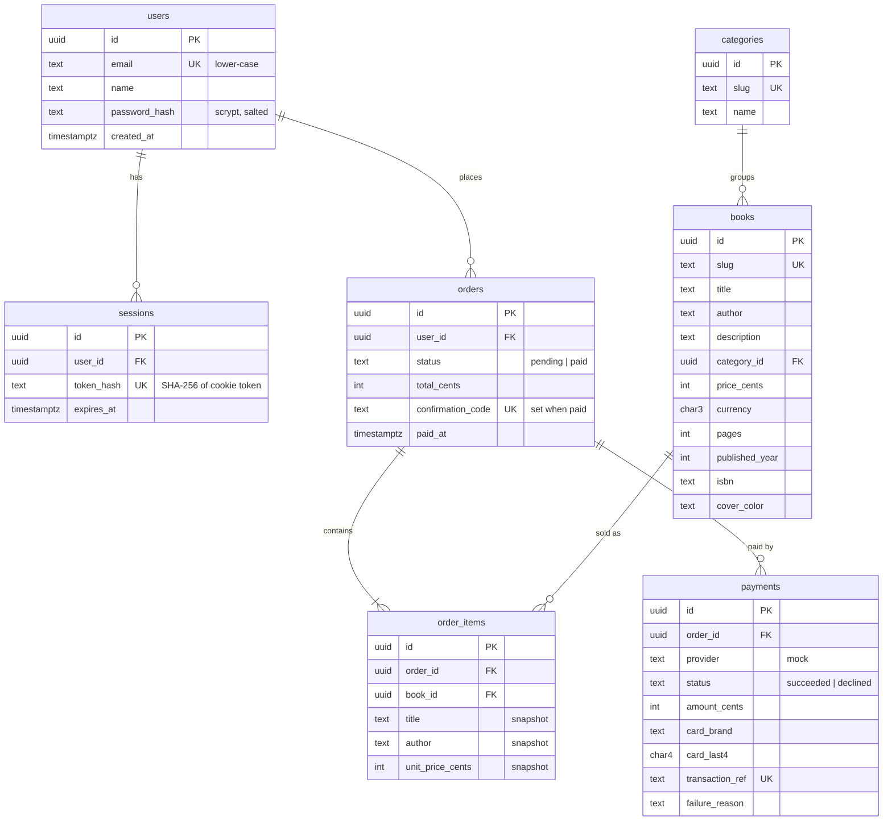

# Data model

Database: **PostgreSQL 18** (works on 15+). Source of truth: [`db/schema.sql`](../db/schema.sql); sample data: [`db/seed.sql`](../db/seed.sql).

> This is a draft derived from the app's screens (catalogue, book detail, login/register, cart, checkout,
> orders/confirmation). Compare it with your wireframes and adjust before treating it as final.

## Wireframe → entity mapping

| Screen | Needs | Entities |
| --- | --- | --- |
| Login / Register | Account, persistent login | `users`, `sessions` |
| Catalogue (filter by category, search) | Browsable list | `books`, `categories` |
| Book detail | Full metadata + price | `books`, `categories` |
| Cart | Client-side only (localStorage), no table | – |
| Checkout (mocked payment) | Order + payment attempt | `orders`, `order_items`, `payments` |
| Purchase confirmation / order history | Confirmation code, line items, card last 4 | `orders`, `order_items`, `payments` |

## ER diagram

## Design decisions

- **Money as integer cents.** No floating point arithmetic on prices; formatting happens only in the UI.
- **Order items snapshot title, author and price.** Order history stays correct if the catalogue changes later.
- **Paid-state invariant in the database.** `CHECK ((status = 'paid') = (confirmation_code IS NOT NULL AND paid_at IS NOT NULL))`.
- **Declined attempts are kept.** A declined payment inserts a `payments` row and leaves the order `pending`, so the user can retry against the same order.
- **Sessions are server-side.** The cookie holds a random opaque token; only its SHA-256 hash is stored, so a database leak does not leak usable sessions. Logout deletes the row.
- **No sensitive card data.** Only brand and last four digits are stored. Full card number and CVC are validated in memory and discarded.
- **Email uniqueness is case-insensitive** (a `CHECK` forces lower-case and the unique index is on that column).
- **No cart table.** The cart lives in the browser until checkout; the server recomputes prices from `books` when the order is created, so a tampered client cannot change a price.
- **Indexes** cover each foreign key and the two hot paths: order history (`user_id, created_at DESC`) and session expiry.
